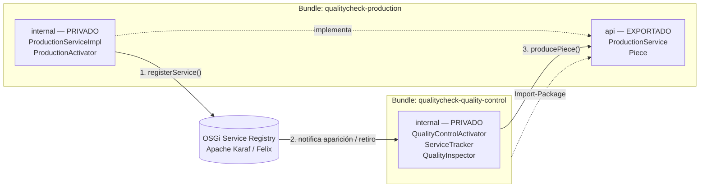
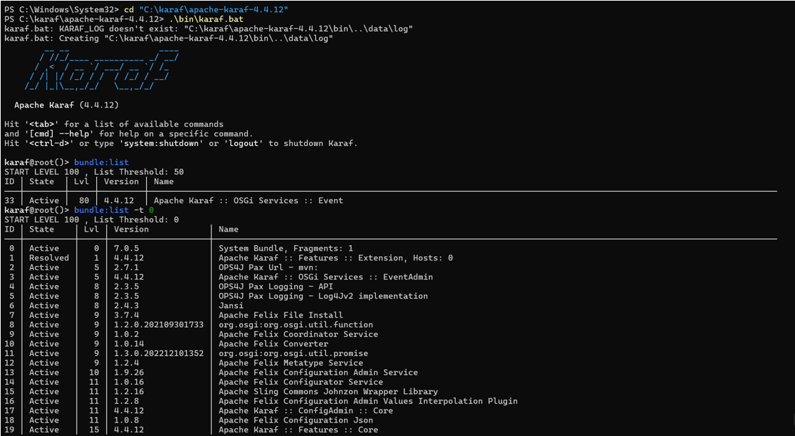
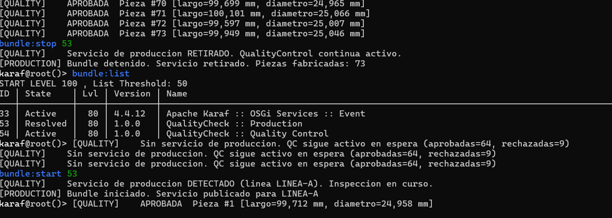
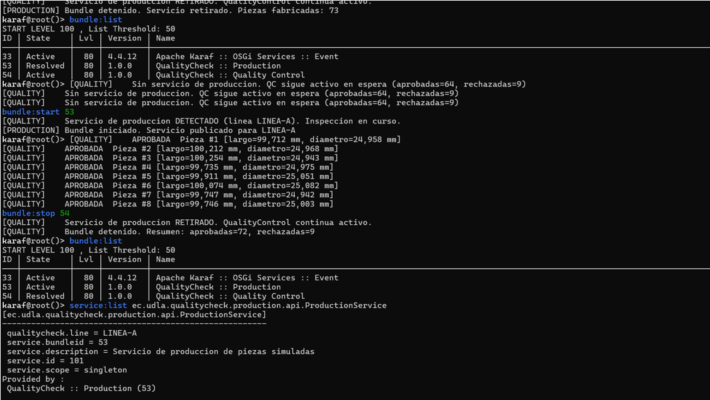
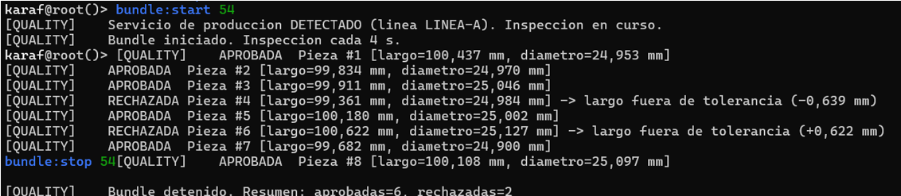
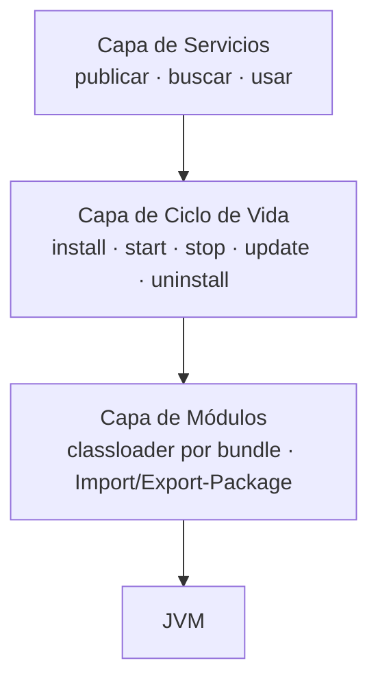
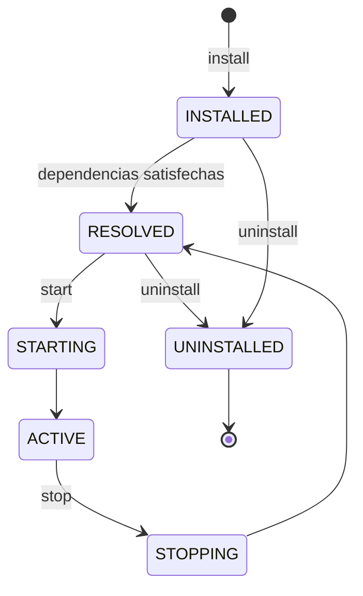

<div align="center">

# QualityCheck OSGi

**Sistema de control de calidad industrial modular construido sobre OSGi y Apache Karaf**


Dos bundles OSGi **débilmente acoplados** que se comunican mediante el registro de servicios,
y que pueden **arrancarse, detenerse y actualizarse en caliente** sin afectar al resto del sistema.

[Descripción](#descripción) •
[Arquitectura](#arquitectura) •
[Instalación](#instalación) •
[Procedimiento](#procedimiento-y-pruebas-en-karaf) •
[Teoría](#fundamento-teórico)

</div>

---

## Descripción

| Bundle | Rol | Qué hace |
|:--|:--|:--|
| **Production** | Proveedor | Fabrica piezas con medidas simuladas (largo y diámetro) y **publica** `ProductionService` en el registro OSGi. Aproximadamente un 15 % de las piezas sale con defectos. |
| **Quality Control** | Consumidor | **Descubre** el servicio de producción en tiempo de ejecución, inspecciona una pieza cada 4 s y la **aprueba o rechaza** según tolerancias. |

> [!IMPORTANT]
> Quality Control **nunca** instancia la implementación de Production: solo conoce su interfaz.
> Si Production se detiene, Quality Control sigue activo en espera y se reconecta solo cuando el servicio vuelve.

---

## Arquitectura



### Claves del bajo acoplamiento

- **Solo se exporta el contrato.** El paquete `api` (interfaz + modelo) es público; `internal` queda oculto por el classloader de OSGi.
- **Vinculación dinámica.** La conexión ocurre en tiempo de ejecución a través del *Service Registry*, no con `new`.
- **Tolerancia a fallos.** El `ServiceTracker` detecta cuando el servicio desaparece o reaparece, y el hilo de inspección nunca se cae.
- **Sin dependencias extra.** Se usa `BundleActivator` directamente, sin Declarative Services ni features adicionales.

### Estructura del proyecto

```
QualityCheck-OSGi/
├── pom.xml                                   # POM padre (multi-módulo)
├── docs/                                     # Capturas de las pruebas
├── qualitycheck-production/
│   ├── pom.xml
│   └── src/main/java/ec/udla/qualitycheck/production/
│       ├── api/                              # Exportado
│       │   ├── Piece.java
│       │   └── ProductionService.java
│       └── internal/                         # Privado
│           ├── ProductionActivator.java
│           └── ProductionServiceImpl.java
└── qualitycheck-quality-control/
    ├── pom.xml
    └── src/main/java/ec/udla/qualitycheck/quality/internal/   # Privado
        ├── InspectionResult.java
        ├── QualityControlActivator.java
        └── QualityInspector.java
```

### Tolerancias de inspección

| Medida | Valor nominal | Tolerancia | Rango aceptado |
|:--|:--:|:--:|:--:|
| Largo | 100,00 mm | ± 0,50 mm | 99,50 – 100,50 mm |
| Diámetro | 25,00 mm | ± 0,15 mm | 24,85 – 25,15 mm |

---

## Requisitos

| Herramienta | Versión | Verificar con |
|:--|:--|:--|
| JDK | 17 o superior (probado con 21) | `java -version` |
| Apache Maven | 3.8 o superior (probado con 3.9.12) | `mvn -version` |
| Apache Karaf | 4.4.x (probado con 4.4.12) | — |

---

## Instalación

### 1. Clonar y compilar

```powershell
git clone https://github.com/alira21/QualityCheck-OSGi.git
cd QualityCheck-OSGi
mvn clean install
```

Al terminar, los bundles quedan instalados en el repositorio local de Maven (`~/.m2`):

```
[INFO] QualityCheck :: Parent ............................. SUCCESS
[INFO] QualityCheck :: Production ......................... SUCCESS
[INFO] QualityCheck :: Quality Control .................... SUCCESS
[INFO] BUILD SUCCESS
```

### 2. Instalar Apache Karaf (Windows / PowerShell)

<details>
<summary>Ver comandos de instalación</summary>

```powershell
$version = "4.4.12"
New-Item -ItemType Directory -Force -Path "C:\karaf" | Out-Null
Invoke-WebRequest -Uri "https://archive.apache.org/dist/karaf/$version/apache-karaf-$version.zip" -OutFile "$env:TEMP\karaf.zip"
tar -xf "$env:TEMP\karaf.zip" -C "C:\karaf" --exclude "*/examples/*"
```

> [!TIP]
> Se usa `tar` excluyendo `examples/` porque esa carpeta contiene rutas que superan el límite de 260 caracteres de Windows y hacen fallar a `Expand-Archive`.

</details>

---

## Procedimiento y pruebas en Karaf

### Paso 1 — Arrancar Karaf

```powershell
cd C:\karaf\apache-karaf-4.4.12
.\bin\karaf.bat
```

Karaf arranca y muestra la consola `karaf@root()>`. Con `bundle:list -t 0` se ven todos los bundles del sistema:
el **System Bundle (ID 0)** es Apache Felix, el núcleo del framework OSGi, es decir, el *microkernel* sobre el que se
enchufa todo lo demás.

```
bundle:list -t 0
```



---

### Paso 2 — Instalar los bundles

Instalar **primero Production**, porque Quality Control importa su paquete `api`:

```
bundle:install -s mvn:ec.udla/qualitycheck-production/1.0.0
bundle:install -s mvn:ec.udla/qualitycheck-quality-control/1.0.0
bundle:list
```

Ambos quedan `Active` y Quality Control empieza a inspeccionar piezas cada 4 segundos:

```
53 │ Active │  80 │ 1.0.0 │ QualityCheck :: Production
54 │ Active │  80 │ 1.0.0 │ QualityCheck :: Quality Control

[QUALITY]    APROBADA  Pieza #3 [largo=99,911 mm, diametro=25,046 mm]
[QUALITY]    RECHAZADA Pieza #4 [largo=99,361 mm, diametro=24,984 mm] -> largo fuera de tolerancia (-0,639 mm)
```

> [!NOTE]
> Los IDs de los bundles (en este proyecto, `53` y `54`) pueden variar en otra instalación. Consúltalos siempre con `bundle:list`.

---

### Paso 3 — Detener y reiniciar Production sin afectar a Quality Control

```
bundle:stop 53
bundle:list
bundle:start 53
```

Al detener Production, su servicio se retira del registro. Quality Control **sigue activo**, conserva sus contadores
y queda en espera. Al reiniciar Production, Quality Control **detecta el servicio por sí solo** y retoma la inspección.

| Bundle | Tras `bundle:stop 53` | Tras `bundle:start 53` |
|:--|:--:|:--:|
| Production | `Resolved` | `Active` |
| Quality Control | `Active` (en espera) | `Active` (inspeccionando) |



---

### Paso 4 — Detener Quality Control sin afectar a Production

```
bundle:stop 54
bundle:list
service:list ec.udla.qualitycheck.production.api.ProductionService
bundle:start 54
```

Quality Control se detiene y muestra su resumen. Production sigue `Active` y `service:list` confirma que su servicio
**continúa registrado** aunque nadie lo consuma.

| Bundle | Tras `bundle:stop 54` |
|:--|:--:|
| Production | `Active` (servicio publicado) |
| Quality Control | `Resolved` |



---

### Paso 5 — Actualización en caliente

Se corrige el código de Quality Control, se recompila y se carga la nueva versión **sin detener Production**:

```powershell
# En PowerShell
mvn clean install
```

```
# En Karaf
bundle:update 54
bundle:start 54
```

La nueva versión inspecciona piezas, las aprueba o rechaza indicando el motivo, y al detenerse muestra solo su
resumen final.



<details>
<summary>Comandos útiles de diagnóstico</summary>

| Comando | Para qué sirve |
|:--|:--|
| `bundle:list` | Ver bundles y su estado |
| `bundle:list -t 0` | Ver también los bundles internos del sistema |
| `bundle:headers 53` | Ver el `MANIFEST.MF` generado (Export/Import-Package) |
| `bundle:diag 54` | Explicar por qué un bundle no resuelve |
| `service:list <interfaz>` | Ver quién publica un servicio |
| `bundle:update 54` | Cargar en caliente una nueva versión del bundle |
| `log:tail` | Seguir el log de Karaf (`Ctrl+C` para salir) |

</details>

---

## Fundamento teórico

### ¿Qué es OSGi?

OSGi es una especificación para construir aplicaciones Java **modulares y dinámicas**. La unidad de despliegue es el
**bundle**: un JAR con metadatos adicionales en su `MANIFEST.MF`. El framework se organiza en capas:



### Ciclo de vida de un bundle



### Patrones de arquitectura

| Patrón | Cómo se manifiesta en OSGi |
|:--|:--|
| **Microkernel / Plug-in** *(principal)* | El framework (Felix dentro de Karaf) es un núcleo mínimo; toda la funcionalidad se añade como bundles enchufables. |
| **Orientado a servicios (SOA en la JVM)** | Modelo *publish – find – bind* a través del Service Registry. |
| **En capas** | La especificación separa módulos, ciclo de vida, servicios y seguridad. |
| **Patrones de diseño asociados** | Service Registry / Locator, Inversión de Dependencias, Whiteboard. |
---

<div align="center">

**Diseño y Arquitectura de Software** · Semana 7 — OSGi

</div>
